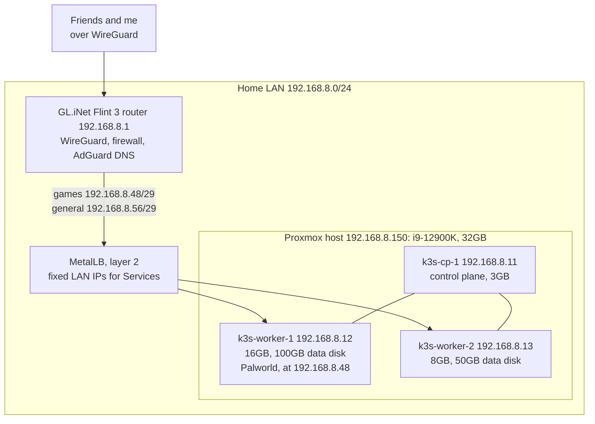
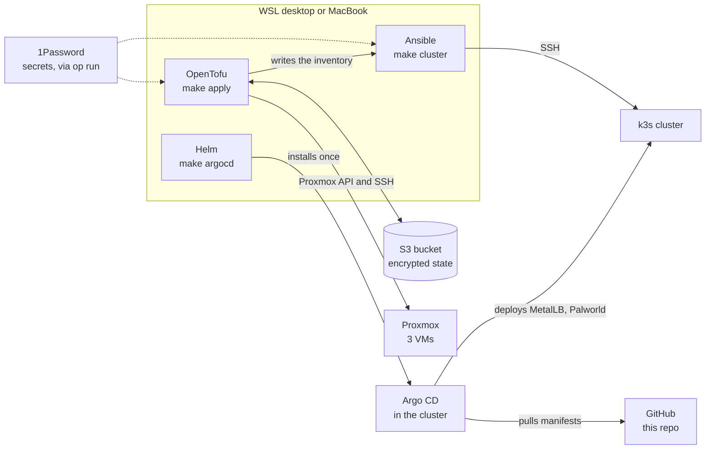

# homelab-infra

Infrastructure-as-code for a single-node Proxmox homelab: a three-node k3s
cluster created with OpenTofu, configured with Ansible, and used to run game
servers for friends. Built as a platform engineering portfolio project. The
whole cluster can be destroyed and rebuilt from this repo.

## Architecture

What runs where, and how traffic reaches it:



How it gets built:



Design choices and their trade-offs are recorded in [docs/adr](docs/adr).

## Status

- [x] Palworld server on a VM, reachable over WireGuard
- [x] OpenTofu with client-side encrypted state in a versioned S3 bucket
- [x] k3s cluster provisioned by OpenTofu, configured by Ansible
- [x] MetalLB giving Services fixed LAN addresses
- [x] Lint CI (OpenTofu, Ansible, secret scanning)
- [x] GitOps with Argo CD ([phase 2](docs/plans/phase-2-gitops-palworld.md))
- [x] Palworld running on the cluster (phase 2); the old VM is kept, shut down, until it's retired
- [x] Secrets from 1Password via External Secrets, encrypted at rest in k3s ([phase 3](docs/plans/phase-3-external-secrets.md))
- [ ] Router WireGuard peers and firewall rules managed by Ansible ([phase 4](docs/plans/phase-4-router-as-code.md))
- [ ] Observability (VictoriaMetrics + Grafana), phase 5

Nice to have, not scheduled: off-host backups of the Palworld volume, Reloader
(restart pods when a Secret changes), and a deploy flow for personal projects
with Argo CD Image Updater.

Each phase has a plan in [docs/plans](docs/plans): a runbook with a checklist,
kept afterwards as a record of how the work was done.

## Set up a clone

Do this first, on every machine you work from. Git doesn't clone hooks, so each
clone needs it once:

```bash
git clone https://github.com/AustianoSC/homelab-infra.git
cd homelab-infra
pipx install pre-commit      # or: brew install pre-commit
make hooks
```

From then on, every `git commit` first runs:

- **gitleaks**, which blocks a commit that contains a secret;
- whitespace, final-newline, YAML-syntax, merge-conflict and large-file checks;
- `tofu fmt` on `.tf` files;
- when anything under `kubernetes/` changes, a render-and-validate of every
  manifest Argo CD would deploy (`helm template` and `kubeconform`). It needs
  `helm`, `kubeconform` and network access; offline, use
  `SKIP=k8s-validate git commit`.

Hooks that fix files (whitespace, newlines, `tofu fmt`) fail the commit once:
review the change, `git add` it, and commit again. `git commit --no-verify`
skips the hooks, so CI runs the same secret scan as a backstop. The config is
[`.pre-commit-config.yaml`](.pre-commit-config.yaml); the slower checks
(`tflint`, `ansible-lint`, `tofu validate`) are in `make lint` and CI.

## Run it

You need an existing Proxmox host, an S3 bucket for state, and a 1Password
vault with the secrets listed in the `.env.tpl` files. The one-time setup
(Proxmox API user, bucket, ssh key, 1Password items) is in
[docs/bootstrap.md](docs/bootstrap.md).

Tools: [OpenTofu](https://opentofu.org) 1.8+, Ansible, `helm`, `kubectl`, the
1Password CLI (`op`) and the AWS CLI. `make lint` also needs `ansible-lint`,
[tflint](https://github.com/terraform-linters/tflint) (`brew install tflint` on
macOS; on Linux, the install script in its README) and
[kubeconform](https://github.com/yannh/kubeconform) (`brew install kubeconform`;
on Linux, download the binary from its releases page). `make validate` keeps its
one Python dependency in a private virtualenv (`.venv-validate`, pinned in
`scripts/requirements.txt`), so it needs only `python3` with `venv`. Then, from
the repo root:

```bash
make up                                  # VMs, k3s, then Argo CD, which deploys the rest
```

`make` with no arguments lists every target. The individual steps are:

| Command | What it does |
| --- | --- |
| `make plan` | Preview OpenTofu changes (read-only) |
| `make apply` | Create or update the three VMs |
| `make cluster` | Configure the nodes and install k3s (safe to repeat) |
| `make argocd` | Install Argo CD and point it at this repo; it deploys MetalLB, Palworld and the rest |
| `make eso-token` | Put the 1Password service account token in the cluster, so External Secrets can read the `homelab-k8s` vault (`make up` does this) |
| `make kubeconfig` | Refresh `~/.kube/homelab.yaml`, e.g. on a new machine |
| `make validate` | Render the Helm charts and validate the Kubernetes manifests, no cluster needed |
| `make lint` | Run the same checks as CI (includes `make validate`) |

## Use it

```bash
export KUBECONFIG=~/.kube/homelab.yaml
kubectl get nodes          # three nodes, Ready
kubectl get svc -A         # Traefik should hold 192.168.8.56
k9s
```

Everything on the cluster is deployed by Argo CD from this repo: merge to `main`
and it applies the change within a few minutes. Its UI is at
`https://192.168.8.57` (self-signed certificate).

Nodes are reachable as `austin@192.168.8.11`, `.12` and `.13` with the SSH
key registered in `infra/access.tf`.

## Destroy

```bash
make destroy
```

This deletes all three VMs **and their disks**, including anything stored in
persistent volumes (game worlds). Back up what you want to keep first. OpenTofu
asks for confirmation before it deletes anything.

## Rebuild from zero

```bash
make rebuild
```

That is `make destroy` followed by `make up`. The VMs come back with new SSH
host keys, so `make up` clears the old ones from `known_hosts` for you. Argo CD
redeploys every workload from Git, but their data is not restored: a rebuilt
Palworld starts with an empty world.

## Repository layout

```
infra/       OpenTofu: Proxmox VMs for the k3s nodes, Ansible inventory
ansible/     Ansible: node baseline and k3s install
kubernetes/  What Argo CD deploys: argocd/ (itself and the app list),
             infra/ (MetalLB), apps/ (Palworld)
apps/        Workloads still outside the cluster (Docker Compose)
docs/        adr/ decision records, plans/ runbooks, bootstrap.md one-time setup
Makefile     Entry points for all of the above
```

## Secrets

No secrets live in this repository, encrypted or otherwise. Files ending in
`.env.tpl` contain 1Password secret references (`op://vault/item/field`) and are
safe to commit. The real values are injected at run time:

```bash
op run --env-file=.env.tpl -- <command>
```

CI has no credentials at all: it only lints, and never runs `apply`. Argo CD
reads this public repo with no credentials. Secrets the cluster needs come from
1Password through External Secrets Operator: an `ExternalSecret` in Git (for
example `kubernetes/apps/palworld/externalsecret.yaml`) names the item and field,
and the operator creates the Kubernetes Secret. Only the read-only service
account token for the `homelab-k8s` vault is loaded by hand (`make eso-token`).
See [ADR 0008](docs/adr/0008-external-secrets-for-1password.md).

## Networking

Nothing is exposed on the public IP except the router's WireGuard listener.
Administration and friends' game traffic both arrive over WireGuard terminated
on the router. Friends' peers are restricted by the router firewall to the DNS
server and the game servers, so they can't reach the rest of the LAN.

Every game server gets a fixed address from the `192.168.8.48/29` block, and
friends' `AllowedIPs` and the firewall rule name that block, so adding a game
needs no change on either side. Internal names use `.internal` through AdGuard
Home, since macOS reserves `.local` for mDNS.

| Name | Address |
| --- | --- |
| Router, AdGuard DNS (`router.internal`) | `192.168.8.1` |
| Proxmox host (`homelab.internal`) | `192.168.8.150` |
| Palworld VM (`palworld.internal`, shut down) | `192.168.8.119` |
| k3s nodes | `192.168.8.11` - `192.168.8.13` |
| MetalLB `games` pool | `192.168.8.48/29`: Palworld `.48`, the rest free for future games |
| MetalLB `general` pool | `192.168.8.56/29`: Traefik `.56`, Argo CD `.57` |
| DHCP pool | `192.168.8.100` - `192.168.8.249` |

## Hardware

| Component | Spec | Proxmox storage |
| --- | --- | --- |
| CPU | Intel i9-12900K (8 P-cores + 8 E-cores, 24 threads) | |
| RAM | 32GB DDR5 | |
| GPU | NVIDIA GTX 1080 (8GB, reserved for later passthrough) | |
| Boot | 500GB SATA SSD (Proxmox VE 9) | `local`, `local-lvm` |
| Fast storage | 1TB NVMe (k3s node boot disks) | `nvme-ssd-1tb` |
| Bulk storage | 1TB SATA SSD (application data) | `sata-ssd-1tb` |
| Backups | 2TB 7200rpm HDD | `hdd-2tb` |

The 32GB memory ceiling is the defining constraint of this project: the three
nodes take 27GB, which is why the old 20GB Palworld VM has to stay shut down.
